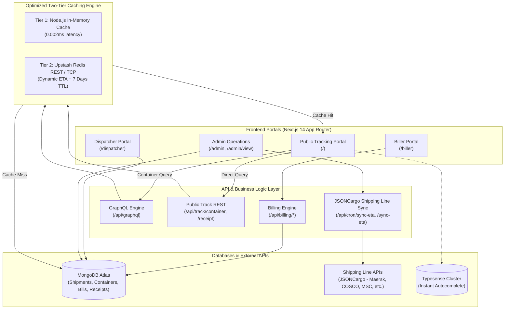
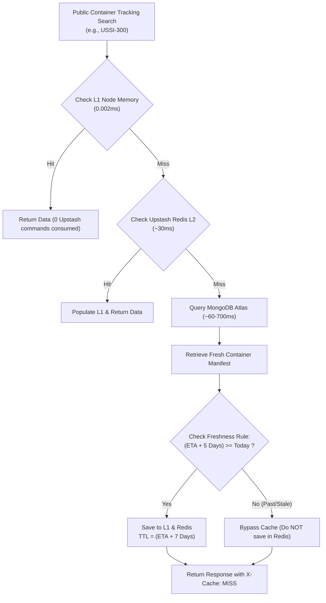

# 🚢 US International Logistics — Cargo & Fleet Tracker (ETA-USI)

[](https://eta-usi.vercel.app/)
[](https://nextjs.org/)
[](https://www.typescriptlang.org/)
[](https://www.mongodb.com/)
[](https://upstash.com/)
[](https://graphql.org/)
[](https://tailwindcss.com/)

**Live Production Link:** [https://eta-usi.vercel.app/](https://eta-usi.vercel.app/)

**ETA-USI** is a full-stack, enterprise-grade maritime cargo tracking, warehouse inventory, freight billing, and dispatch automation suite built for **US International Logistics**. It delivers end-to-end operational visibility: from loading at origin ports (China/Global) to Indian destination customs clearance, billing with official Government of India NIC-format e-Way Bills, and gate dispatch.

---

## 📑 Table of Contents

- [Live Production](#-live-production)
- [System Architecture](#-system-architecture)
- [Core Portals & Features](#-core-portals--features)
  - [1. Public Cargo Tracking Portal](#1-public-cargo-tracking-portal)
  - [2. Biller & e-Way Bill Engine](#2-biller--e-way-bill-engine)
  - [3. Dispatcher & Gate Pass Portal](#3-dispatcher--gate-pass-portal)
  - [4. Admin Master Operations & Fleet Manager](#4-admin-master-operations--fleet-manager)
  - [5. Warehouse Management System (WMS)](#5-warehouse-management-system-wms)
  - [6. Visitor Analytics & Audit Logs](#6-visitor-analytics--audit-logs)
- [Upstash Redis Two-Tier Caching Engine](#-upstash-redis-two-tier-caching-engine)
- [Project Directory Structure](#-project-directory-structure)
- [API & GraphQL Reference](#-api--graphql-reference)
- [Database Models](#-database-models)
- [Environment Configuration](#-environment-configuration)
- [Getting Started & Local Setup](#-getting-started--local-setup)
- [Deployment (Vercel)](#-deployment-vercel)

---

## 🌐 Live Production

The system is deployed and active in production:
- **Main Public Tracking & Application:** [https://eta-usi.vercel.app/](https://eta-usi.vercel.app/)
- **Biller Workspace:** [https://eta-usi.vercel.app/biller](https://eta-usi.vercel.app/biller)
- **Dispatcher Workspace:** [https://eta-usi.vercel.app/dispatcher](https://eta-usi.vercel.app/dispatcher)
- **Admin Control Center:** [https://eta-usi.vercel.app/admin](https://eta-usi.vercel.app/admin)
- **Live Fleet Manifest Directory:** [https://eta-usi.vercel.app/admin/view](https://eta-usi.vercel.app/admin/view)

---

## 🏗️ System Architecture



---

## 🚀 Core Portals & Features

### 1. Public Cargo Tracking Portal
**Accessible at:** [`/`](https://eta-usi.vercel.app/)

- **Dual-Mode Tracking**:
  - **Search by Container Number**: Tracks by container alias (e.g., `USSI-300`, `USI-01`) or carrier container code (e.g., `TCLU4605019`, `MSCU1234567`).
  - **Search by Warehouse Receipt (Confidential)**: Tracks exact customer receipts (e.g., `REC-1002`). To maintain customer privacy, receipts are strictly excluded from public autocomplete.
- **Multi-Warehouse Duplicate Protection**: If a single receipt exists across multiple China warehouses (e.g., Yiwu, Guangzhou), the customer is prompted to enter their carton count (`CTN`) printed on the warehouse receipt to verify ownership before disclosing cargo data.
- **Smart Query Auto-Detection**: If a user types a container number pattern while on the receipt tab, the system automatically detects the container prefix (`USI`, `USSI`, ISO-6346) and routes to container tracking.
- **Milestone Timeline**:
  - **Port Date**: Arrival of vessel at Indian port.
  - **Destination ETA**: Delivery at Inland Container Depot (ICD) or customer hub.
  - **Turnaround Days**: Computed turnaround time between receipt entry and delivery.
- **Client-Side PDF Tracking Slip**: Customers can export a branded PDF summary with status, QR codes, and contact info.

---

### 2. Biller & e-Way Bill Engine
**Accessible at:** [`/biller`](https://eta-usi.vercel.app/biller)

- **GST Freight Invoice Generation**:
  - Full itemization of sea freight, cartage, handling charges, and CGST/SGST/IGST breakdown.
  - Reverse Charge Mechanism (RCM) calculations.
  - Automatic conversion of numbers to formal currency text (Indian numbering format).
- **Official Government of India (NIC) e-Way Bill Generator** ([`lib/ewayBillPdf.ts`](file:///c:/Users/USER/Desktop/last/anti/lib/ewayBillPdf.ts)):
  - Generates authentic Government of India standard e-Way Bills matching official portal printouts.
  - **Part-A**: e-Way Bill No., Generation Date, Valid Until, GSTIN of Supplier & Recipient, Place of Delivery, Document No., HSN Code, Goods Value, Reason for Transportation.
  - **Part-B**: Vehicle Mode, Vehicle Number, Place, Entered Date, Multi-vehicle tracking.
  - **Barcodes & Security**: High-density **Code 128 1D Barcode** and **2D QR Matrix** containing encrypted payload verification.
- **Consolidated "Print Both (Invoice + e-Way)" PDF**:
  - Generates a unified 2-page print document:
    - **Page 1**: Tax Invoice.
    - **Page 2**: Government e-Way Bill.
- **Instant e-Way Bill Assignment**: Prompt at bill generation allowing billing staff to input/save the 12-digit e-Way bill number directly from the creation success banner.

---

### 3. Dispatcher & Gate Pass Portal
**Accessible at:** [`/dispatcher`](https://eta-usi.vercel.app/dispatcher)

- **Delivery & Gate Pass Authorization**:
  - Assign transport vehicle number and record gate dispatch time.
  - Updates cargo status to **Delivered / Dispatched**.
  - Synchronizes status across linked `WarehouseReceipt`, `Shipment`, and `Container` records.
- **Real-Time Eviction**: When a container is dispatched as delivered, the system immediately purges its cached record from Upstash Redis to ensure customers do not see stale in-transit statuses.
- **One-Click Consolidated Printing**: Disptachers can re-print single Invoices, e-Way Bills, or combined 2-page documents right from the dispatch table.

---

### 4. Admin Master Operations & Fleet Manager
**Accessible at:** [`/admin`](https://eta-usi.vercel.app/admin) and [`/admin/view`](https://eta-usi.vercel.app/admin/view)

- **Manifest Bulk Upload**:
  - Upload Excel manifests (`.xlsx`, `.xls`, `.csv`).
  - Automatically deduplicates and maps columns (Receipt, Commodity, Packaging, Chinese Name, English Name, Cartons, Weight, Volume, Marka, Party).
- **Automated Shipping Line Live API Sync** ([`lib/jsoncargo.ts`](file:///c:/Users/USER/Desktop/last/anti/lib/jsoncargo.ts)):
  - Integrates with maritime carrier APIs (Maersk, MSC, COSCO, CMA CGM, ONE, Hapag-Lloyd, Evergreen).
  - Fetches vessel names, voyage numbers, port ETA, destination arrival dates, and container events.
  - Daily scheduled cron at 7:00 AM (`/api/cron/sync-eta`) for fleet-wide updates.
- **Manual ETA & Buffer Management**:
  - Super Admin overrides for manual ETAs, buffer days, destination ICDs, and remarks.
  - Port Date + Grace Period destination calculations.
- **Loading Plans & Cargo Containerization**:
  - Allocate warehouse stock into containers.
  - Finalize plans, allocate actual carrier containers, and track remaining loose warehouse cargo.

---

### 5. Warehouse Management System (WMS)
**Accessible at:** [`/admin`](https://eta-usi.vercel.app/admin) (Warehouse Tab)

- Manage receipt intake at origin facilities (e.g., Guangzhou, Yiwu, Ningbo).
- Stock statuses: `In Stock`, `Partially Loaded`, `Fully Loaded`, `Partially Dispatched`, `Delivered`.
- Warehouse transfer operations with complete batch audit trails.

---

### 6. Visitor Analytics & Audit Logs
**Accessible at:** [`/admin/visitors`](https://eta-usi.vercel.app/admin/visitors)

- Real-time logging of customer search behavior, queried container numbers, receipts, IP addresses, city/country location, browser, and device telemetry.
- Traffic anomaly detection and search volume audit.

---

## ⚡ Upstash Redis Two-Tier Caching Engine

Designed specifically to operate with maximum speed while adhering to the **Upstash Redis Free Tier** (10,000 commands/day, 256MB memory):



### Key Caching Rules

1. **Targeted Caching (Container Search Only)**:
   - Only `public:track:container:*` queries access Upstash Redis.
   - Search suggestions, autocomplete keystrokes, receipts, and internal admin operations bypass Redis, ensuring zero quota wastage.
2. **Freshness Criterion (`ETA + 5 Days`)**:
   - If `(ETA + 5 Days) >= Today`: Container is actively tracked and saved in cache.
   - If `(ETA + 5 Days) < Today`: Container arrival is in the past; it is **never saved to Redis**, saving storage space.
3. **Dynamic TTL (`ETA + 7 Days`)**:
   - Expiration TTL is set dynamically to **`ETA + 7 Days`**. Active in-transit containers stay cached throughout their journey without expiring prematurely.
4. **Auto-Eviction on Delivery**:
   - When a container is delivered (via `/api/containers/deliver`, dispatcher, or loading plan), it is immediately deleted from Redis (`deleteCache`) to prevent stale statuses.
5. **Dual-Key Mirroring**:
   - Containers are indexed by alias (e.g. `public:track:container:ussi300`) and carrier code (e.g. `public:track:container:tclu4605019`), ensuring instant lookup regardless of user input format.
6. **Stampede & Concurrency Protection**:
   - Duplicate concurrent requests for the same container share a single in-flight promise (`inFlightPromises`), preventing database hammering.

---

## 📁 Project Directory Structure

```text
anti/
├── app/                              # Next.js 14 App Router
│   ├── page.tsx                      # Public Cargo Tracking Portal
│   ├── layout.tsx                    # Root application layout & metadata
│   ├── globals.css                   # Tailwind styling & animations
│   ├── biller/                       # Freight Billing & e-Way Bill Workspace
│   │   └── page.tsx
│   ├── dispatcher/                   # Dispatch & Gate Pass Workspace
│   │   └── page.tsx
│   ├── admin/                        # Operations & Master Administration
│   │   ├── page.tsx                  # Fleet, Manifests, Upload, WMS
│   │   ├── view/page.tsx             # Live Container View
│   │   ├── visitors/page.tsx         # Traffic & Visitor Analytics
│   │   └── login/page.tsx            # Admin Authentication
│   └── api/                          # Backend API Route Handlers
│       ├── graphql/route.ts          # Unified GraphQL Server & Resolvers
│       ├── track/                    # Public Tracking Endpoints
│       │   ├── container/route.ts    # Container Tracking + Dynamic TTL
│       │   └── receipt/route.ts      # Confidential Receipt Tracking
│       ├── containers/               # Container Fleet CRUD & Sync
│       │   ├── deliver/route.ts      # Delivery status recording & cache eviction
│       │   ├── manual-eta/route.ts   # Manual ETA override
│       │   └── sync-eta/route.ts     # Carrier API sync
│       ├── billing/                  # Billing & Dispatch APIs
│       │   └── dispatch/route.ts     # Delivery dispatch & vehicle assignment
│       ├── loading-plan/route.ts     # Container cargo planning
│       ├── warehouse/                # China Warehouse receipts & transfers
│       ├── upload/route.ts           # Excel manifest bulk ingest
│       └── cron/sync-eta/route.ts    # Automated shipping line sync cron
├── lib/                              # Core Utility & Service Modules
│   ├── redis.ts                      # Two-Tier Caching Engine (L1 + Upstash L2)
│   ├── ewayBillPdf.ts                # Government NIC e-Way Bill PDF Engine
│   ├── billPdf.ts                    # GST Tax Invoice PDF Generator
│   ├── dateUtils.ts                  # Universal Date Parsing & Turnaround Maths
│   ├── mongodb.ts                    # MongoDB Mongoose Connection Pool
│   ├── jsoncargo.ts                  # Maritime Carrier Tracking API Integration
│   ├── auth.ts                       # Role-Based JWT Authentication Guards
│   └── typesense.ts                  # High-Speed Autocomplete Search Client
├── models/                           # Mongoose Schema Definitions
│   ├── Shipment.ts                   # Individual cargo item / manifest row
│   ├── Container.ts                  # Master fleet container entity
│   ├── WarehouseReceipt.ts           # Origin China warehouse receipt
│   ├── Bill.ts                       # Generated GST Tax Invoice
│   ├── User.ts                       # Staff & Admin user credentials
│   └── VisitorLog.ts                 # Search audit & visitor telemetry
├── public/                           # Static assets, logos, and icons
├── .env                              # Base environment variables
├── .env.local                        # Local development overrides & secrets
├── next.config.mjs                   # Next.js optimization configuration
├── tailwind.config.ts                # Tailwind CSS styling framework
└── tsconfig.json                     # TypeScript compiler options
```

---

## 🔌 API & GraphQL Reference

### GraphQL (`POST /api/graphql`)

The system exposes a unified GraphQL endpoint for high-speed tracking and operations:

```graphql
# Track Container by Alias or Carrier Code
query TrackContainer($container: String!) {
  trackByContainer(container: $container) {
    success
    container
    containerNumber
    portDate
    eta
    dateOfDelivery
    deliveryDate
    isDelivered
    daysToDeliver
    status
    destinationDate
    remarks
    shipments {
      id
      receipt
      english
      commodity
      quantity
      weight
      volume
      status
    }
  }
}
```

```graphql
# Track Customer Receipt (Confidential)
query TrackReceipt($receipt: String!, $cartons: Int) {
  trackByReceipt(receipt: $receipt, cartons: $cartons) {
    success
    count
    receipt
    requiresCartonVerification
    message
    warehouseReceipt {
      receipt
      party
      warehouse
      quantity
      status
    }
    shipments {
      container
      quantity
      status
      deliveryDate
    }
  }
}
```

### Key REST Endpoints

| Method | Endpoint | Description | Access |
| :--- | :--- | :--- | :--- |
| `GET` | `/api/track/container?container=...` | Fast public container tracking (with Redis cache) | Public |
| `GET` | `/api/track/receipt?receipt=...&cartons=...` | Confidential customer receipt tracking | Public |
| `POST` | `/api/billing` | Create and save GST freight bills | Staff / Biller |
| `POST` | `/api/billing/dispatch` | Dispatch bills, assign vehicle, mark delivered | Dispatcher |
| `POST` | `/api/containers/deliver` | Mark container delivered & purge cache | Staff / Admin |
| `POST` | `/api/containers/manual-eta` | Override ETA, destination ICD, or buffer days | Super Admin |
| `POST` | `/api/upload` | Parse & bulk ingest Excel manifest spreadsheet | Staff / Admin |
| `GET` | `/api/cron/sync-eta` | Scheduled cron job to sync shipping line tracking | Cron / Secret |

---

## 🗄️ Database Models

- **`Container`**: Master record containing container alias (`USSI-300`), carrier container code (`TCLU4605019`), shipping line (COSCO, Maersk), port arrival date, destination ETA, ICD location, delivery status, and remarks.
- **`Shipment`**: Granular cargo item tied to a specific receipt number, packaging code, weight (kg), volume (CBM), commodity, party, and assigned container.
- **`WarehouseReceipt`**: Origin intake records from China facilities (Yiwu, Guangzhou), tracking loaded vs. remaining warehouse inventory.
- **`Bill`**: Freight invoices with party details, itemized tax rates, subtotal, GST amounts, e-Way bill number, and vehicle allotment.
- **`VisitorLog`**: Telemetry capturing user queries, timestamps, IP geolocation, user agents, and referral sources.

---

## ⚙️ Environment Configuration

Create a `.env.local` file in the root directory:

```env
# MongoDB Atlas Database
MONGO_URI="mongodb+srv://<username>:<password>@<cluster>.mongodb.net/<database>?appName=Cluster0"
MONGO_DB="cargo_tracker_v2"

# Upstash Redis (REST & TCP Connection)
UPSTASH_REDIS_REST_URL="https://<your-database>.upstash.io"
UPSTASH_REDIS_REST_TOKEN="<your-upstash-token>"
REDIS_URL="rediss://default:<your-upstash-token>@<your-database>.upstash.io:6379"

# Shipping Line Carrier Tracking API
JSON_CARGO_API_KEY="<your-jsoncargo-api-key>"

# Security & Authentication Secrets
JWT_SECRET="<your-secure-jwt-secret>"
CRON_SECRET="<your-cron-secret-token>"

# Portal Passwords
ADMIN_PASSWORD="<admin-password>"
EADMIN_PASSWORD="<super-admin-password>"
BILLER_PASSWORD="<biller-password>"
DISPATCHER_PASSWORD="<dispatcher-password>"
DEV_ADMIN_PASSWORD="<dev-password>"

# Optional: Typesense Cluster (For Autocomplete)
NEXT_PUBLIC_TYPESENSE_HOST="<typesense-host>"
NEXT_PUBLIC_TYPESENSE_PORT="443"
NEXT_PUBLIC_TYPESENSE_PROTOCOL="https"
NEXT_PUBLIC_TYPESENSE_SEARCH_KEY="<typesense-search-key>"
```

---

## 🛠️ Getting Started & Local Setup

### Prerequisites

- **Node.js**: v18.17.0 or higher (v20+ recommended)
- **Package Manager**: npm or yarn
- **MongoDB Atlas** database account
- **Upstash Redis** account

### Installation

1. **Clone the repository:**
   ```bash
   git clone https://github.com/i4uzats011-max/ETA10sept.git
   cd ETA10sept
   ```

2. **Install dependencies:**
   ```bash
   npm install
   ```

3. **Configure Environment Variables:**
   ```bash
   cp .env.example .env.local
   # Edit .env.local with your MongoDB and Upstash Redis credentials
   ```

4. **Run the local development server:**
   ```bash
   npm run dev
   ```
   Open [http://localhost:3000](http://localhost:3000) in your browser.

5. **Type check & build for production:**
   ```bash
   npm run build
   npm run start
   ```

---

## ☁️ Deployment (Vercel)

The application is optimized for deployment on **Vercel**:

1. **Connect GitHub Repository**: Link `i4uzats011-max/ETA10sept` to your Vercel project.
2. **Configure Environment Variables**:
   In the **Vercel Dashboard** under **Settings > Environment Variables**, add:
   - `MONGO_URI` and `MONGO_DB`
   - `UPSTASH_REDIS_REST_URL` and `UPSTASH_REDIS_REST_TOKEN`
   - `REDIS_URL`
   - `JSON_CARGO_API_KEY`
   - `JWT_SECRET` and `CRON_SECRET`
   - Portal passwords (`ADMIN_PASSWORD`, `BILLER_PASSWORD`, `DISPATCHER_PASSWORD`, etc.)
3. **Build Command**: `next build`
4. **Deploy**: Push changes to `main` branch to trigger automatic zero-downtime builds.

---

## 📄 License & Attribution

Developed for **US International Logistics**. Proprietary software. All rights reserved.  
For technical support or inquiries, visit [https://eta-usi.vercel.app/](https://eta-usi.vercel.app/).
